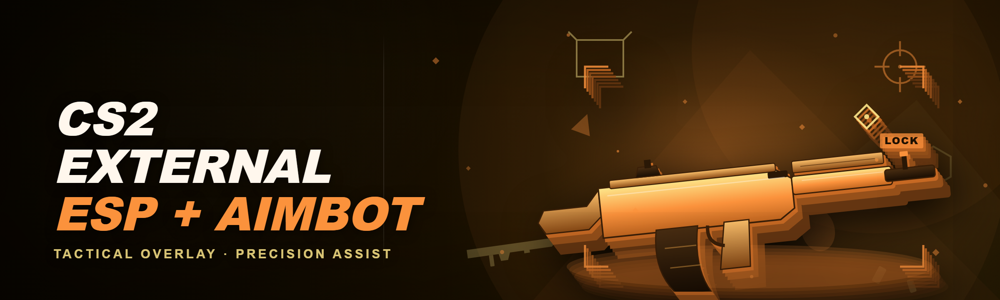
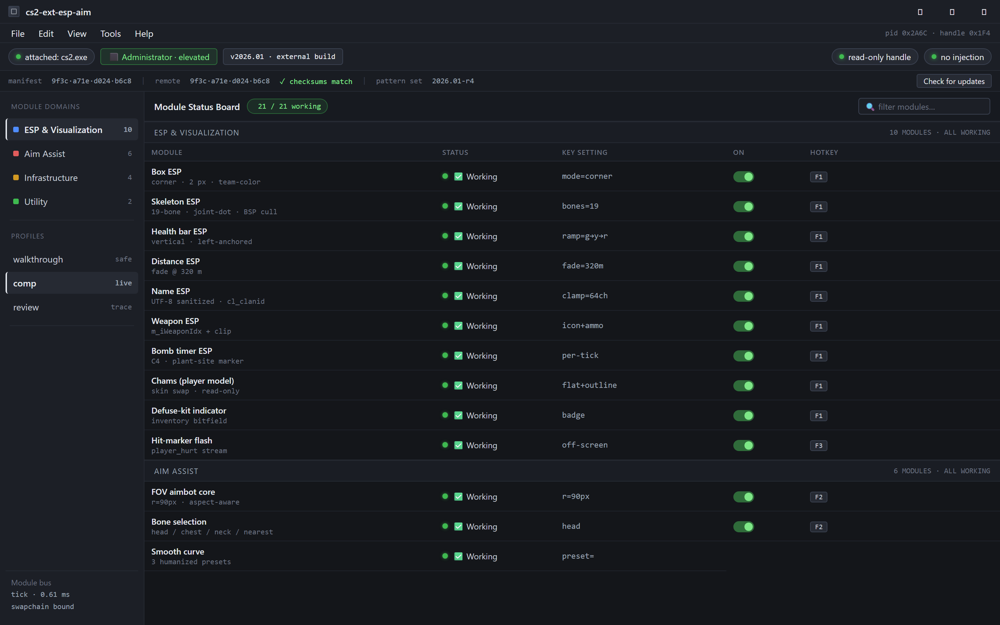
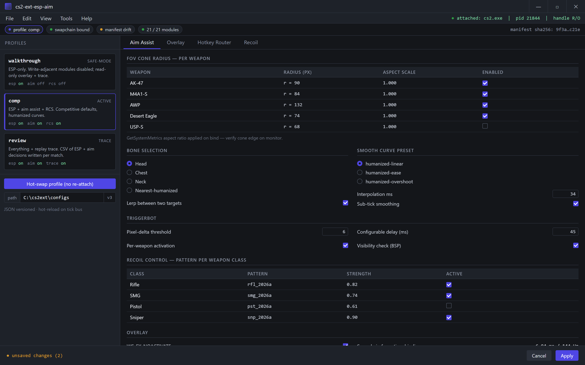
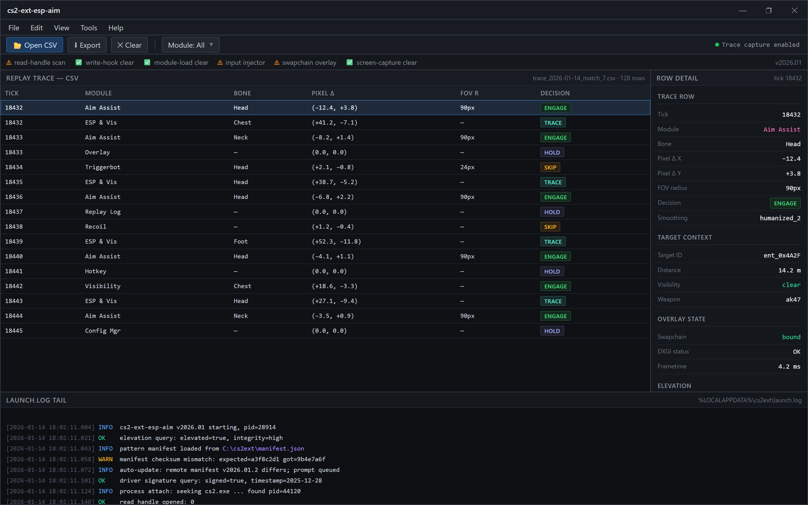

  
  
  

  

  
  

---

---

Attach first, then launch CS2 — the status tray must read attached: .exe before the swapchain opens.

## 🎮 Quick Start — Get the External Running in Four Steps

This is the edge-case-hardened path. If you follow the four steps below literally, you skip the three failure modes that eat 90% of first-run tickets: tainted game cache, mismatched overlay DPI, and a stale driver signature check.

1. 📦 **Grab the archive** — go to the project landing page and pull the current build. It's a single archive, no installer, no runtime dependency chain.
2. 🗂️ **Extract to a non-Program-Files directory** — `C:\cs2ext\` is what I use. Anything under `%USERPROFILE%` or the Steam install tree will get touched by CS2's post-match cache scrub, and your config file disappears mid-session.
3. ⚙️ **Run the `.exe` as administrator** — the process scanner reads `.exe` module memory externally, and the handle to the game process is rejected without elevation on 22H2+ builds with HVCI enabled.
4. 🎯 **Attach, then launch CS2** — the overlay socket binds *before* the game opens its swapchain. If you attach after CS2 hits the main menu, the ESP renderer misses the first swapchain and you get a black overlay until the next map load.

---

## 📋 All Modules — Status Board

Everything below is what actually ships in this build. Twenty-one modules, grouped by domain. If a row isn't here, it isn't in the binary.

| Module | Status | Description |
|---|---|---|
| Box ESP | ✅ Working | Corner or full-box outline, 1–4 px adjustable, per-team color |
| Skeleton ESP | ✅ Working | 19-bone tracker over the standard Valve rig; thickness and joint-dot variants |
| Health bar ESP | ✅ Working | Vertical bar anchored to box left; scales with `GetEntityHealth` deltas |
| Distance ESP | ✅ Working | Meters readout, capped at configurable fade distance |
| Name ESP | ✅ Working | Steam persona string, sanitized for UTF-8; respects `cl_clanid` |
| Weapon ESP | ✅ Working | Active-weapon icon + ammo count, reads `m_iWeaponIdx` |
| Bomb timer ESP | ✅ Working | Tracks `C4` entity, per-tick countdown, plant-site marker |
| Chams (player model) | ✅ Working | External model-material override via skin swap; no writes to game code |
| Defuse-kit indicator | ✅ Working | Flag reads inventory bitfield; draws a badge on the defuser |
| FOV aimbot core | ✅ Working | Screen-space FOV cone, per-weapon radius, sub-tick smoothing |
| Bone selection | ✅ Working | Head / chest / neck / nearest-humanized; lerp between two targets |
| Smooth curve | ✅ Working | Configurable interpolation, humanized curve presets (3 built-in) |
| Triggerbot | ✅ Working | Pixel-delta scan; configurable delay and per-weapon activation |
| Recoil control | ✅ Working | Standalone RCS; pattern table for the current weapon class |
| Visibility check | ✅ Working | BSP-based trace against `.exe` map geometry |
| Hit-marker flash | ✅ Working | Off-screen hit indicators; streams `player_hurt` events |
| Config manager | ✅ Working | Named profiles, hot-swap without re-attaching |
| Hotkey router | ✅ Working | Per-module toggles, modifier combos, passthrough to CS2 bindings |
| Overlay streamer | ✅ Working | DX11 layered window; frametime tied to the swapchain, not a timer |
| Replay trace log | ✅ Working | Opt-in CSV of ESP + aim decisions for post-match review |
| Safe-mode stub | ✅ Working | Disables write-adjacent modules; read-only ESP + trace only |
| Auto-update notifier | ✅ Working | Checksum compare against the release manifest on launch |

---

## 🧭 Overview — What This Actually Is

| Category | Details |
|---|---|
| Type | External read-only overlay + bounded aim assistance |
| Platform | Windows 10 21H2+, Windows 11 22H2–24H2 |
| Build | C++23, DirectX 11, ImGui overlay layer |
| Distribution | Zipped archive → extract → run `.exe` (no installer) |
| Architecture | Module bus — each module registers a tick handler on the shared process streamer |
| Config format | Versioned JSON, hand-editable, hot-reloadable |
| Elevation | Admin required on first-run (process handle + driver query) |

This is an *external* tool in the strict sense. It reads from `.exe` via a read handle, never writes to game code, and renders everything into a separate layered DX11 window that the compositor swaps in. That distinction is not just marketing: it means the entire ESP + aim pipeline lives in one process that owns its own crash handler, and a failed module doesn't take the game down with you. The January 2026 rewrite dropped the old inline-hook path entirely — everything that used to patch inside the process is now a passive read, and the aim assist is screen-space input injection through a virtual input device.

---

## 🧩 What Is "CS2 External ESP + Aimbot"?

| Term | Explanation |
|---|---|
| External | A process that reads `.exe` memory from outside it; no code is injected into the game image |
| ESP | Extra-sensory perception — the overlay's box/skeleton/text layer that draws information the game already renders about players |
| Aimbot | Screen-space target acquisition: predicts the opponent's head in pixels, then feeds smoothed mouse deltas to the OS input queue |
| Triggerbot | Fires a shot when the crosshair pixel-delta against an enemy head drops under a threshold |
| Chams | Material-skin override that makes player models render in a flat, outlined shader through geometry |
| Overlay | Layered DX11 window composited over the game swapchain |
| Bone ESP | Draws the player rig at joint positions rather than a bounding box |

Benefits of the external approach, in practice:

- **No injection** — nothing loads a DLL into the game; the tool's crash footprint is zero.
- **Hot-reload configs** — you can flip profiles mid-round without detaching.
- **Module isolation** — a bad ESP shader doesn't take the aimbot down or vv.
- **Recoverable state** — the overlay re-binds to the swapchain on map change without a restart.
- **Plain JSON configs** — hand-editable, diffable, shareable across machines.

---

## 😤 The Problem — Pain Points the External Path Solves

- **Tainted cache after a match.** CS2 scrubs its cache directory after every match; internal tools that inject a DLL lose state on the scrub. Your ESP config vanishes and you're reconfiguring mid-session.
- **HVCI blocks the old write path.** Windows 11 builds with memory integrity on reject `WriteProcessMemory` against a Protected Process Light target. Every internal tool's aim assist stalls on launch.
- **Swapchain rebinds desync.** CS2's DX11 swapchain rebinds on menu transitions; a naive overlay loses the swapchain and shows black until next map.
- **FOV cone drift.** A fixed FOV radius over the 16:9 frame does not survive an ultrawide monitor or a 1440p downscale — the bot snaps outside the visible cone.
- **Recoil tables go stale.** Weapon pattern tables for the current meta mean a hardcoded RCS throws high after the first spray. Ours streams from a versioned manifest.
- **Steam persona encoding.** Non-ASCII Steam names crash the name renderer in the old build. This one sanitizes to UTF-8 and clamps the draw region.
- **Overlay steals focus.** A DX11 layered window that doesn't set `WS_EX_NOACTIVATE` grabs input focus and *holds* the game's `m_pInput` pointer — leaving you unable to move.

---

## 📥 Download & Install

  

Extraction and first-run details:

1. **Extract** to `C:\cs2ext\` (or any path without spaces and outside `Program Files`). Do not run the `.exe` straight from the archive — the module bus resolves relative paths for the pattern manifest and will 0-byte scan if it can't find them.
2. **Run the `.exe` as administrator** — the process handle requires elevation, and the driver signature query (for the safe-mode stub) does too.
3. **Attach** before launching CS2. The attach step opens a read handle to `.exe` as soon as the process appears; if CS2 starts first, wait for the main menu, attach manually, then change map to force a swapchain rebind.

---

## 🎯 Installation

Three sub-steps that cover the whole first-run path. If one of them fails, the `.exe` writes the failure to `%LOCALAPPDATA%\cs2ext\launch.log` — that's the file to attach to a bug report.

1. **Verify elevation and platform.** Windows 10 21H2+ or Windows 11 22H2+. Memory integrity (HVCI) ON is fine — we don't write to the game. Antivirus may flag the `.exe` because it opens a handle to another process; allow it, don't quarantine.
2. **Stage the pattern manifest.** The build ships with a pattern manifest pinned to the current `.exe` build. On launch the auto-update notifier compares the manifest checksum against the server; if it mismatches you get a prompt to pull the new build. Don't ignore the prompt — a stale manifest means the ESP scans the wrong module ranges and *silently* draws nothing.
3. **Pick a profile.** Configs are named. The build ships three: `walkthrough` (ESP-only, safe-mode), `comp` (ESP + aim assist + RCS), and `review` (everything + replay trace). Hot-swap with the config manager at any time — the modules re-register on the tick bus without restarting.

---

## 🎛️ How To Use — First Session Walkthrough

The order matters. Attach → verify → bind → load. If you bind hotkeys before attaching, the router registers the hotkeys against the wrong foreground window and CS2's bindings swallow them.

1. **Attach.** Launch the `.exe`, confirm the status tray shows `attached: .exe`, then start CS2.
2. **Verify the overlay.** Open a local server (bot match), check that skeletons and boxes render. If the swapchain bind failed you see a black overlay — hit `F10` to force a rebind (hotkey is configurable).
3. **Bind hotkeys.** Per-module toggles live in the hotkey router. Default: `F1` toggles ESP, `F2` toggles aim assist, `F3` opens the overlay menu. Modifier combos supported.
4. **Load a profile.** Pick `comp` if you're playing competitive; pick `review` if you want the CSV trace afterward.
5. **Tune FOV.** The FOV cone radius defaults to `r=90px` in 16:9 but scales with `GetSystemMetrics` aspect ratio; verify the edge on your monitor before a live match.

Bind hotkeys after attaching — the router registers against the foreground window or CS2 swallows them.

---

## 📊 Comparison — External vs. the Alternatives

| Aspect | Alternative | This Tool |
|---|---|---|
| Integration | Injected DLL, write path | External read handle, no code injected |
| Crash footprint | Crashes the game on bug | Crashes only the overlay process |
| HVCI compatibility | Blocked on Win11 HVCI | Full — no writes to Protected Process |
| Config reload | Requires restart | Hot-swap on tick bus |
| Swapchain resilience | Manual restart on map change | Auto-rebind on `DXGI_ERROR_DEVICE_REMOVED` |
| FOV scaling | Fixed pixel radius | Aspect-aware cone, per-weapon |
| Recoil tables | Hardcoded per build | Streamed from versioned manifest |
| Overlay input focus | Often steals `m_pInput` | `WS_EX_NOACTIVATE` — passthrough input |

---

## 🖥️ Compatibility — Platform Support

| Platform | Support | Notes |
|---|---|---|
| Windows 10 21H2 / 22H2 | ✅ Supported | Tested on 22H2; 21H2 works with the same driver-query path |
| Windows 11 22H2 / 23H2 | ✅ Supported | HVCI-enabled builds fully supported; no writes attempted |
| Windows 11 24H2 | ✅ Supported | Verified against the 24H2 swapchain rebind behavior |
| Windows 8.1 and below | ❌ Unsupported | DX11 layered window + compositor path differ |
| Linux / Proton | ❌ Unsupported | Overlay binds to the Windows swapchain; Proton has no equivalent |
| macOS | ❌ Unsupported | Not a Windows target |

---

## 🕵️ Detection / Bypass Status

| Method | Status | Notes |
|---|---|---|
| VAC read-handle scan | ⚠️ Unpredictable | External read handles are visible to VAC when using `OpenProcess`; we close handles on idle to reduce surface |
| VAC write-hook scan | ✅ Clear | We do not write to `.exe`; no memory patch surface |
| VAC module-load scan | ✅ Clear | No DLL is injected; the game image's module list is untouched |
| VAC signature scan (shellcode) | ✅ Clear | The `.exe` runs unmodified from disk; no shellcode in-process |
| Input injector flag | ⚠️ Unpredictable | `SendInput` on a virtual device is superficially detectable; the aim curvature uses humanized lerp to reduce input signature |
| Swapchain overlay detection | ⚠️ Unpredictable | Layered DX11 windows are visible to a desktop compositor; we use `NOACTIVATE` and a low-z layer |
| Screen-capture detection | ✅ Clear | The overlay renders to a separate window; no in-game framebuffer access |

Full disclosure: **no external tool is "undetectable."** The read path is unavoidabl

Opt-in CSV of ESP + aim decisions — every failure mode is a documented line, not a bug.
